# Rittel 🃏

**Riddles of the court: Wheel of Fortune meets Wordle, with an endless Gauntlet.**

The court jester poses a riddle. Its answer sits as blank tiles on an old parchment scroll, and you reveal it letter by letter, or solve it early for a big bonus, before your lives run out.

| Daily Riddle | The Gauntlet | Points |
| --- | --- | --- |
| 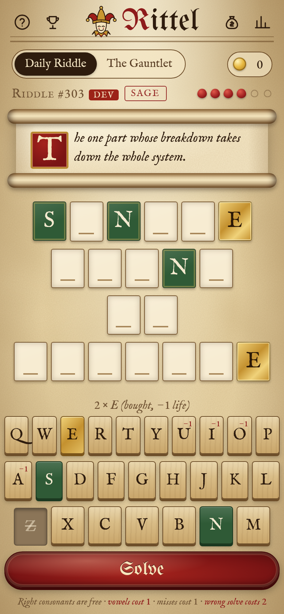 | 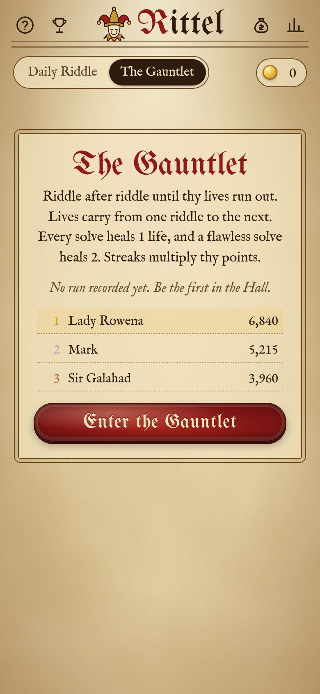 | 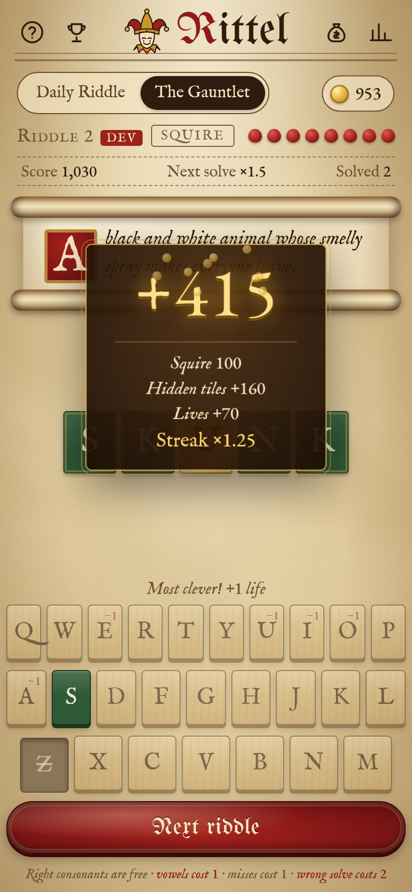 |

## How to play

- **Consonants** are free if they're in the answer. A wrong consonant costs **1 life**.
- **Vowels** (A E I O U) always cost **1 life**, right or wrong, and you can't buy one with your last life.
- **Solve** at any time. A **wrong solve costs 2 lives**, so blind guessing is a real gamble.
- Fill every tile or solve it to win.

## Modes

### Daily Riddle
- One shared riddle per day with **6 lives**, picked from the local date.
- Difficulty follows the week: **Squire on Monday, Knight Tuesday to Thursday, Sage Friday to Sunday**.
- Stats, streaks and a lives-used chart, a countdown to tomorrow's riddle, and a Wordle-style share:

```
Rittel #298 🧩 2/6
🟩🟩⬛🟨🟩⭐
⚜ 790 points
```

🟩 letter found · 🟨 vowel bought · ⬛ miss · 🟥 wrong solve · ⭐ solved

### The Gauntlet (endless)
- Riddle after riddle. The run ends when your lives run out.
- You start with **6 lives**, and lives **carry over** between riddles.
- Every solve heals **1 life**, and a **flawless** solve (no lives lost on that riddle) heals **2**, up to **9**.
- **Yield** skips a riddle for 1 life and resets your streak.
- Difficulty ramps up as the run goes on: mostly Squire at first, mostly Sage after riddle 8.
- Riddles **never repeat** until you've seen the whole bank. Today's daily riddle is always kept out of the Gauntlet.
- Runs are recorded in the **Hall of Fame** with your name.

## Scoring

```
points = (tier base + hidden-tile bonus + 10 × lives left) × streak multiplier      (rounded to 5)
```

| Part | Value |
| --- | --- |
| Tier base | Squire 100 · Knight 200 · Sage 300 |
| Hidden-tile bonus | up to +200% of base: `base × 2 × (tiles still hidden ÷ total tiles)` at the moment you solve |
| Lives bonus | +10 per life left after the solve |
| Streak multiplier | ×1, ×1.25, ×1.5 … capped at ×3. In the Gauntlet it counts consecutive solves in the run; in the Daily it counts consecutive days solved. |

Solving a Sage riddle cold with everything hidden is worth 3× the base, but a miss costs 2 lives. Filling in tiles is safer but scores less.

## Progression: gold and the Armory

Every point you earn also goes into your **gold** purse. Spend it in **the Armory**:

| Item | Price |
| --- | --- |
| Parchment (default; candlelit leather in dark mode) | free |
| Royal Court (purple velvet and gold leaf) | 2,500 |
| Forest Ranger (oak, moss and lantern light) | 4,000 |
| Banish the Ads | 6,000 |
| Dragon's Hoard (obsidian, embers and gold) | 8,000 |

A good Gauntlet run earns about 800 to 2,000 gold, so the first skin comes after a few runs. Skins are pure CSS variable themes (`src/skins.css`).

| Royal Court | Forest Ranger | Dragon's Hoard | Candlelit (dark mode) |
| --- | --- | --- | --- |
| 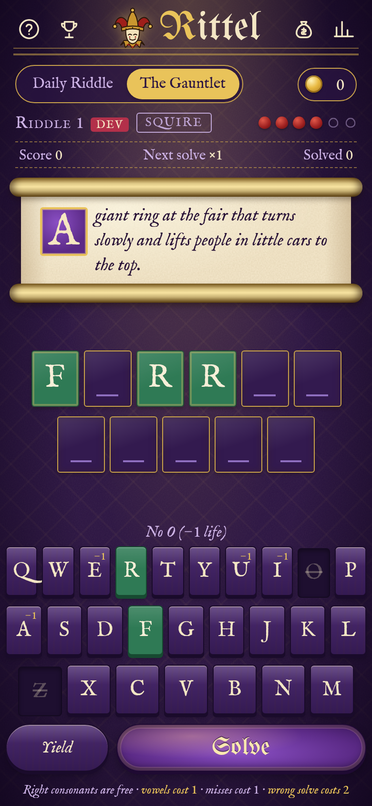 | 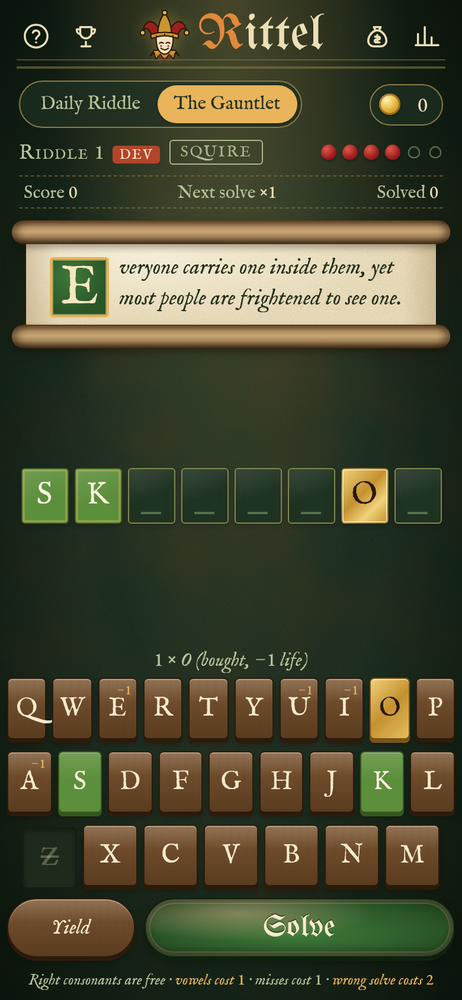 | 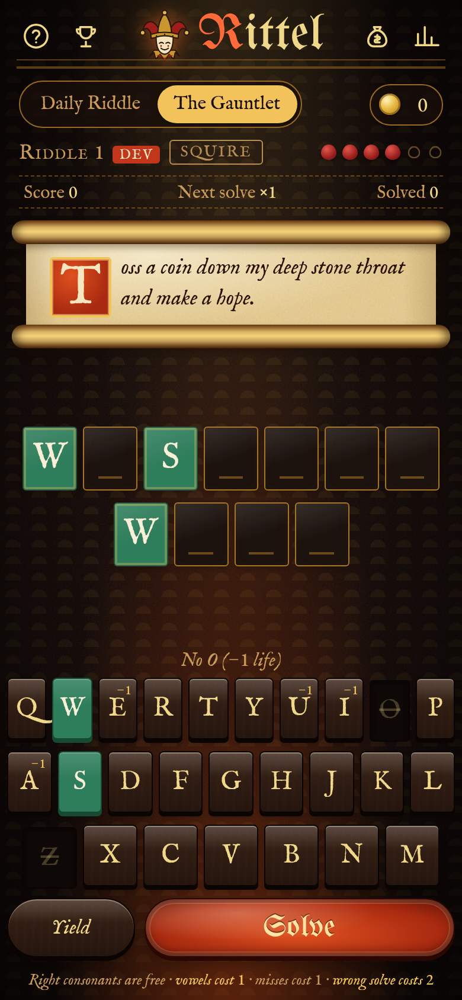 | 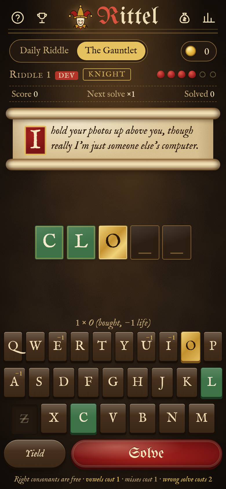 |

| Daily result | Run over | Hall of Fame | Armory |
| --- | --- | --- | --- |
| 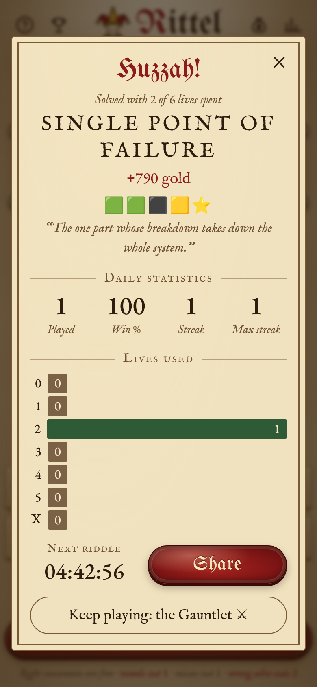 | 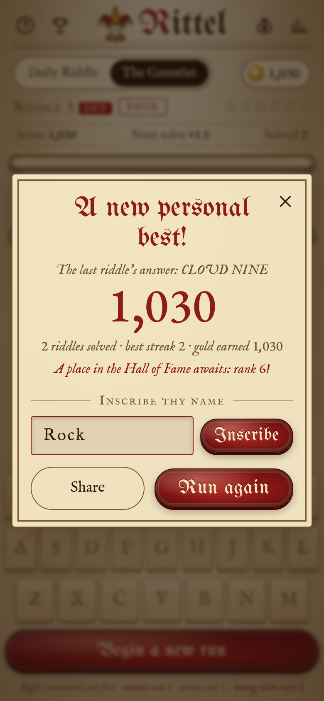 | 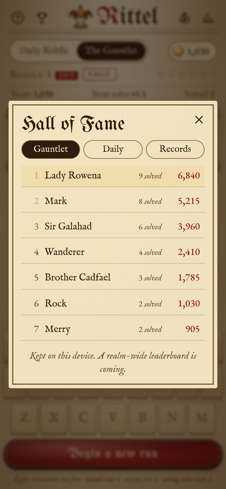 | 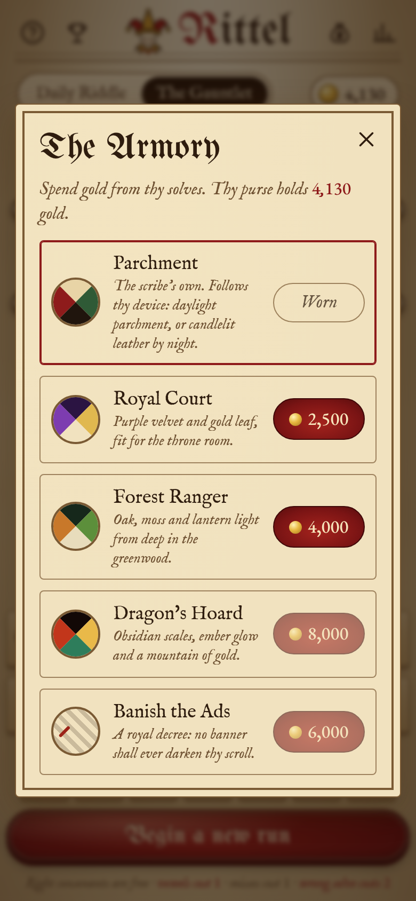 |

## Riddle bank

`src/riddles.txt` holds **374 original riddles**: 126 Squire, 123 Knight and 125 Sage. They are a mix of descriptive riddles, wordplay, idioms, myth and history, and a few for the tech crowd. Each line is `tier|ANSWER|riddle`. The answer is A–Z and spaces only and doubles as the riddle's stable id. The build rejects duplicates, bad characters, unknown tiers or a bank under 250. The tests also check that no riddle gives away its own answer.

## Leaderboard

For now the Hall of Fame is local to the device: top Gauntlet runs with names, best daily scores, and lifetime records. All UI goes through a small adapter in `src/game.js`:

```js
// submitScore(board, entry) -> Promise<{rank}>     board: "gauntlet" | "daily"
// getTop(board, limit)     -> Promise<entry[]>
const Leaderboard = LocalLeaderboard;   // swap in a remote adapter (Supabase, Firebase …) later
```

## Ads (off)

There's an isolated, **disabled-by-default** bottom banner slot (`#adSlot`). With `CONFIG.ADS_ENABLED = false` it renders nothing, takes no space and loads no scripts. It also stays hidden for anyone who owns **Banish the Ads**. When enabled, it reserves a fixed 60px height so the page never jumps when an ad loads.

On the web this would be **Google AdSense**. AdMob is Google's ad network for native iOS/Android apps, so it only applies if Rittel is wrapped as a native app. To turn ads on:
1. Get the site approved in AdSense and create a display ad unit.
2. Set `ADS_ENABLED: true`, `AD_CLIENT: "ca-pub-…"` and `AD_SLOT: "…"` in `CONFIG` at the top of `src/game.js`.
3. Fill in `Ads.load()` to inject the AdSense loader script and an `<ins class="adsbygoogle">` unit into the slot.
4. Add an `ads.txt` file to the site root, add a privacy policy, and set up a consent banner (a CMP) for EU/UK visitors.
5. Re-run the tests. The "no network requests" check is expected to fail once ads are live, so scope it to the non-ad build.

## Development

`index.html` is a single, self-contained, offline file built from `src/`. Don't edit it by hand.

| File | What it holds |
| --- | --- |
| `src/game.html` | page template |
| `src/game.js` | game logic, scoring, modes, shop, leaderboard adapter, ads config |
| `src/riddles.txt` | riddle bank |
| `src/skins.css` / `src/style.css` | skin variables / base styles |
| `src/jester.svg` | logo and favicon |
| `src/fonts/` | OFL font subsets, embedded as base64 |

```sh
python3 src/build.py        # build index.html (validates the riddle bank)
python3 tests/test.py       # end-to-end tests (Playwright + Chrome/Chromium)
python3 tests/shots.py      # regenerate docs/ screenshots
```

- Tests need `pip install playwright` and a Chrome/Chromium, either `playwright install chromium` or the `CHROME=/path/to/chrome` env var.
- `?day=N` plays a specific daily riddle and `?dev=1` turns on dev mode for today. Both use separate dev storage. `&reset=1` wipes dev storage.
- Players' v1 data is migrated automatically. Daily stats and streaks carry over, veterans get 150 gold per past win, and a daily already finished on v1 isn't counted twice.

Pushing to the `dev` branch deploys the test build to GitHub Pages.

## Roadmap

- **Global leaderboard:** a remote adapter (Supabase or Firebase) behind the same `submitScore`/`getTop` interface, with daily and all-time boards and light anti-cheat (server-side validation of solve times).
- **AdSense banner:** turn on the slot described above. **Banish the Ads** becomes a real perk.
- **More skins and cosmetics:** seasonal skins, jester hat variants, tile and seal styles.
- **More riddles:** community submissions and themed weeks.
- Achievements, run modifiers (e.g. "no vowels" for double points) and sound effects.

## Credits

The game code is under the MIT License. The fonts are embedded under the SIL Open Font License (see `src/OFL.txt`): UnifrakturMaguntia, IM Fell English and EB Garamond.
